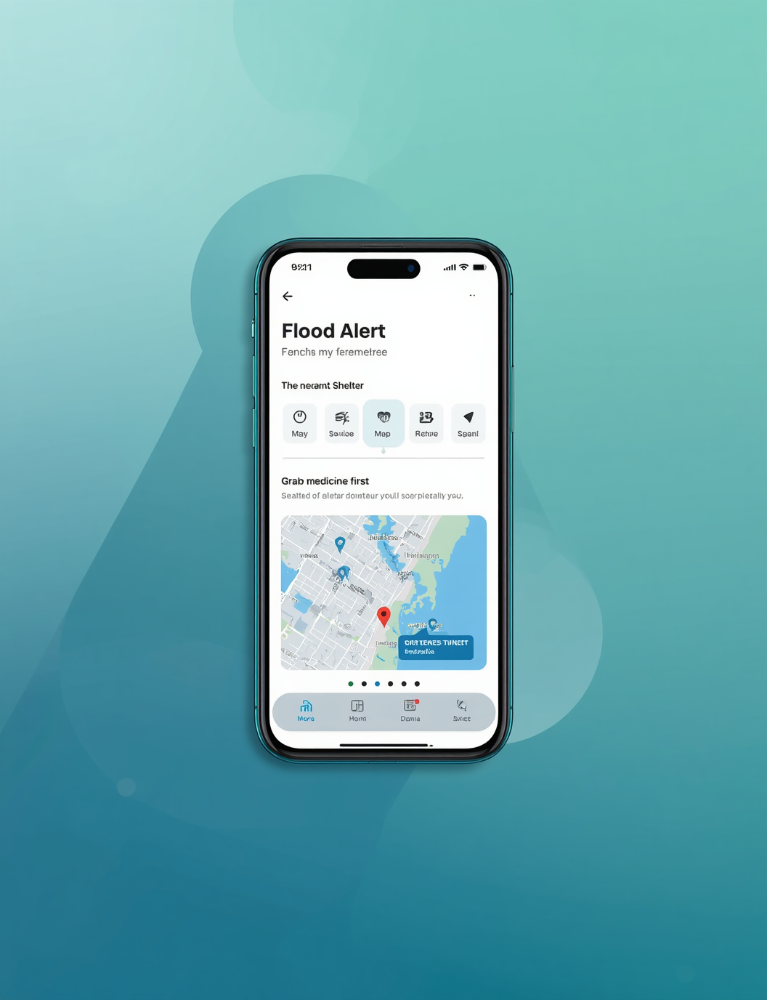
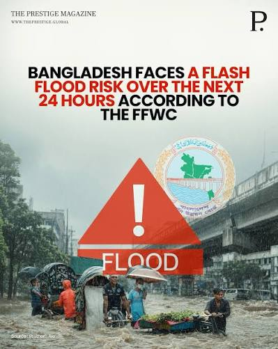
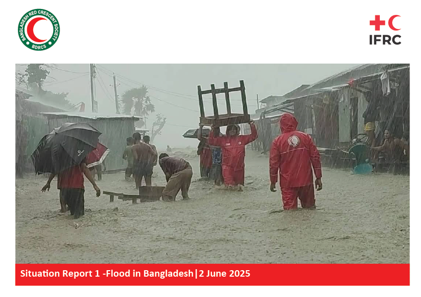
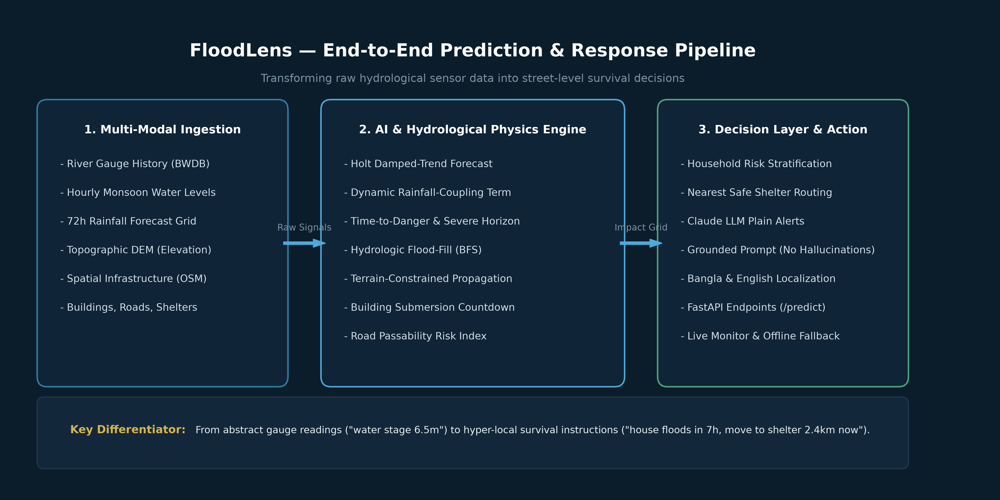
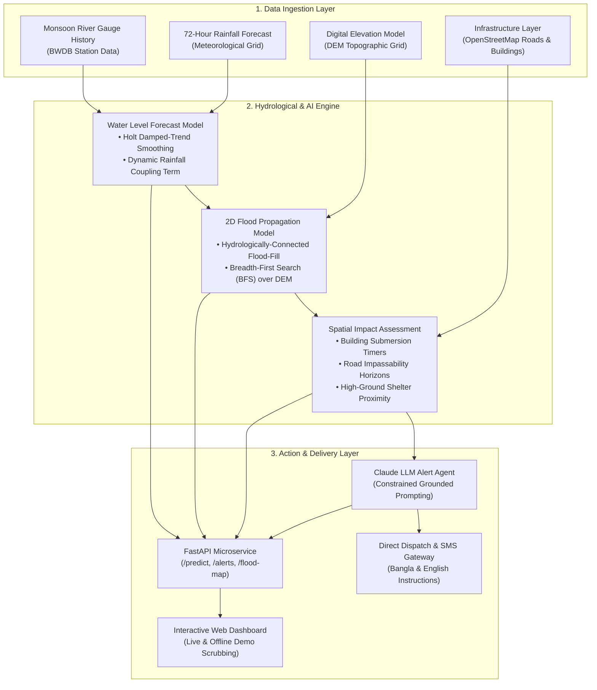
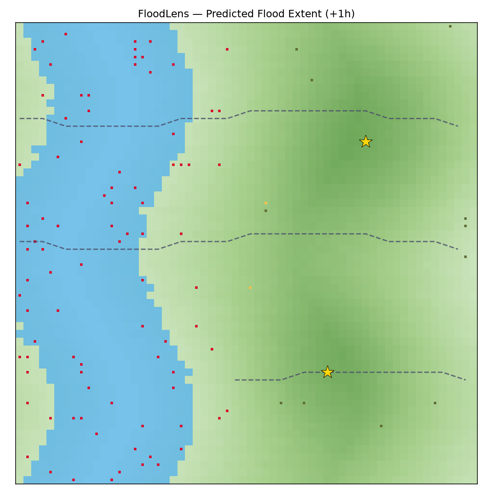
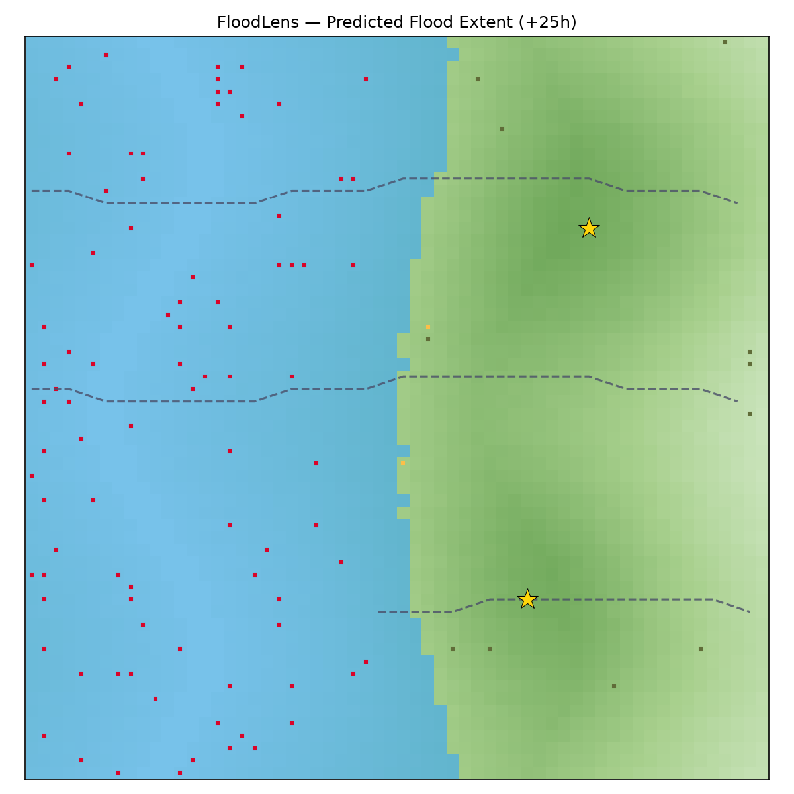
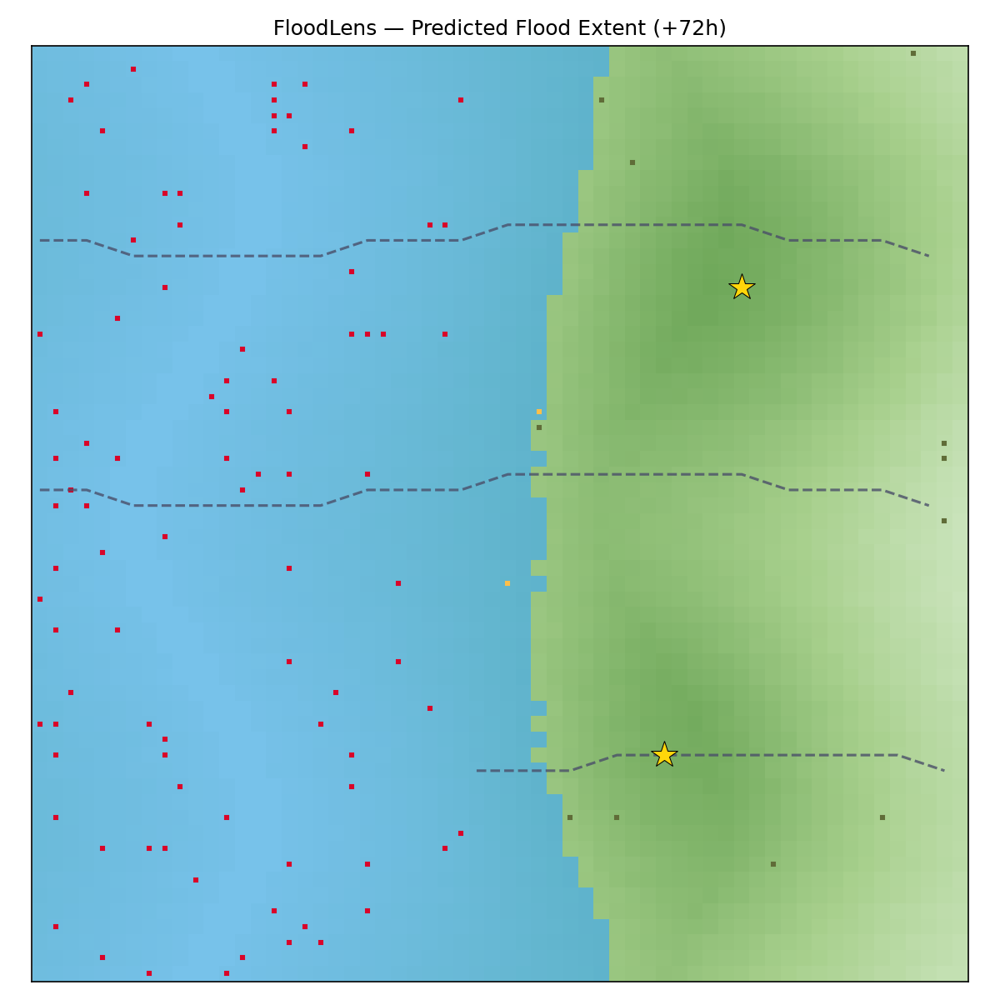
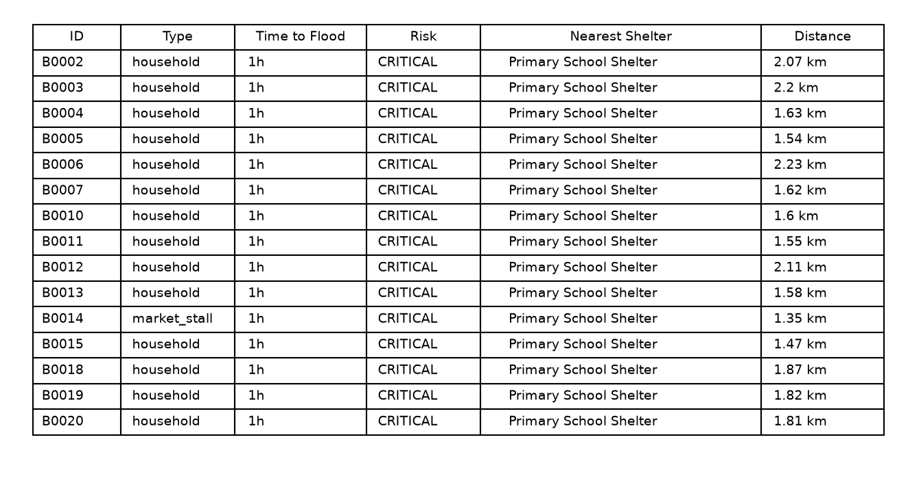

# 🌊 FloodLens — From Flood Warning to Flood Action

<div align="center">

[](https://www.python.org/)
[](https://fastapi.tiangolo.com/)
[](https://nahidzaman1996271-sketch.github.io/floodlens/)
[](https://floodlens-api-vq31.onrender.com/docs)
[](tests/)
[](https://anthropic.com/)
[](https://cloudcampbd.com/)
[](LICENSE)

**Team Candy Crush · International AI Builders Congress · "Idea to Unicorn" Track**

*Hyper-local, street-level flood impact forecasting and plain-language survival instructions for Bangladesh.*

👉 **[Launch Interactive Web Platform](https://nahidzaman1996271-sketch.github.io/floodlens/)** · 📡 **[Explore Live Render API Docs](https://floodlens-api-vq31.onrender.com/docs)**

</div>

---

<div align="center">
  
  <p><em>FloodLens Mobile Experience: Hyper-local timing, nearest safe shelter routing, and prioritized survival instructions.</em></p>
</div>

---

## 📌 Executive Summary

Current flood early-warning systems in Bangladesh tell communities:
> *"River water level: 6.50m (Danger Stage reached)."*

That reading is useful to hydrologists in Dhaka. It is **useless** to a rural family in a Sylhet or Kurigram haor basin trying to decide at 2:00 AM whether to wake their children, unlash their livestock, and evacuate on foot.

**FloodLens bridges the "last mile" gap between detection and survival action.** Instead of abstract water levels, FloodLens computes:
> **"Flooding predicted at your home in 6 hours (CRITICAL risk). Village Access Road 1 is already underwater. Take your medicine and essential documents, and evacuate along the Upazila Connector Road to Char Bandar Primary School Shelter (2.07 km away) now."**

---

## 🔍 The Problem & Ground Reality

Bangladesh is one of the most flood-vulnerable countries on Earth. Every monsoon season, millions face flash floods and river overflow that wash away livelihoods in hours.

<div align="center">
  <table border="0">
    <tr>
      <td width="50%" align="center">
        <br/>
        <strong>Today: Vague, un-actionable headlines</strong>
      </td>
      <td width="50%" align="center">
        <br/>
        <strong>The Reality: Chaos when warnings arrive too late</strong>
      </td>
    </tr>
  </table>
</div>

### Why existing warnings fail the public:
1. **No Street-Level Spatial Resolution**: River gauge stations report district-scale readings; they do not reveal whether *your particular homestead* is above or below the flood line.
2. **No Time Horizon**: Knowing the river is rising does not tell you if you have 45 minutes or 12 hours before your front door is submerged.
3. **No Evacuation Context**: Warnings do not tell you if the only road out of the village is already impassable, or which designated shelter is dry.
4. **Linguistic & Technical Barriers**: Reports are written in technical meteorological jargon rather than urgent, prioritized Bangla and English action steps.

---

## 💡 What FloodLens Delivers: A Personal Survival Plan

FloodLens ingests hydrological sensor streams, precipitation forecasts, and terrain elevation grids to generate household-specific survival guidance:

* **⏱️ Precise Submersion Countdowns**: Real-time projected time-to-flood calculated per building footprint.
* **🛣️ Road Passability Status**: Computes which egress routes remain passable and when they will become inaccessible.
* **📍 Safe Shelter Routing**: Assigns each household to the nearest verified high-ground shelter with distance metrics.
* **🤖 Grounded Claude AI Guidance**: A strictly constrained system prompt produces plain-language alerts (in Bangla and English) that **never hallucinate numbers** and prioritize life-saving essentials (medicine, children, documents, livestock).
* **🖥️ Live Operations Monitor**: A unified dashboard for Union Disaster Management Committees (UDMC) and dispatch teams.

---

## 🏛️ System Architecture

<div align="center">
  
</div>

### End-to-End Pipeline



### Core Algorithms & Modeling Patterns

1. **Water Level Forecasting (`floodlens/models/water_level_forecast.py`)**:
   - Implements **Holt's damped-trend exponential smoothing** augmented with an external **rainfall-coupling transfer term**.
   - Tuned with physical boundary guardrails: hourly rate-of-rise caps and saturation asymptotic bounds to prevent unrealistic explosion during heavy storms.
   - Computes explicit time horizons: `hours_to_danger_level` (6.5m) and `hours_to_severe_level` (8.0m).

2. **Hydrological Flood Propagation (`floodlens/models/flood_propagation.py`)**:
   - Unlike naive thresholding (which marks all low land as flooded regardless of topological connection), FloodLens uses **hydrologically-connected 8-neighbor BFS flood-fill**.
   - Water only propagates from the river channel into low-elevation cells that have a direct contiguous physical path from the riverbank.

3. **Impact Assessment (`floodlens/models/impact_assessment.py`)**:
   - Evaluates all structures against the simulated flood extent across 72 hourly intervals.
   - Categorizes risk levels:
     - `CRITICAL`: Flood reaches building footprint in `< 10 hours`.
     - `HIGH`: Flood reaches building in `10 – 24 hours`.
     - `WATCH`: Flood reaches building in `24 – 72 hours`.
     - `SAFE`: High ground above projected 72-hour flood peak.
   - Determines earliest breach point for each road network segment.

4. **Reliable LLM Alert Generation (`floodlens/alerts/claude_alert.py`)**:
   - Integrates Anthropic's Claude API with a strict system prompt that forbids inventing distances, timings, or names.
   - Features an automatic offline template fallback ensuring the demo and disaster dispatch never fail due to network disconnection or missing API keys.

---

## 📊 Flood Simulation Progression

The simulation below illustrates how FloodLens models the inundation wavefront across Char Bandar Union over a 72-hour monsoon storm surge:

<div align="center">
  <table border="0">
    <tr>
      <td width="33%" align="center">
        <br/>
        <strong>+1 Hour</strong><br/>
        <em>Normal baseline channel (5.08m). Low-lying bank homesteads alerted.</em>
      </td>
      <td width="33%" align="center">
        <br/>
        <strong>+25 Hours</strong><br/>
        <em>Danger stage (6.5m) breached. Village roads 1 & 2 cut off.</em>
      </td>
      <td width="33%" align="center">
        <br/>
        <strong>+72 Hours</strong><br/>
        <em>Severe stage (8.0m). 89.2% of floodplain inundated; shelters secure.</em>
      </td>
    </tr>
  </table>
</div>

### Household Impact Ranking (Top 15 Most Urgent)

<div align="center">
  
  <p><em>Computed household-level triage: Building ID, structure type, time-to-flood, risk status, and assigned safe shelter.</em></p>
</div>

---

## 🖥️ Live Emergency Operations Platform

🌐 **Live Web Deployment**: **[https://nahidzaman1996271-sketch.github.io/floodlens/](https://nahidzaman1996271-sketch.github.io/floodlens/)**

FloodLens includes a production-grade, Bangladeshi-themed national flood monitoring and evacuation command center designed for the Ministry of Disaster Management, Union Disaster Management Committees (UDMC), and local frontline responders:

* **🗺️ Real-World Interactive Leaflet GIS Mapping**:
  - Replaces raw grids with a full **Leaflet.js geospatial map** covering Bangladesh's high-risk river basins.
  - Features real vector layers for the **Surma River channel**, animated flood inundation zones, and **evacuation road networks**.
* **🏛️ Multi-Station Basins (FFWC Telemetry)**:
  - Toggle between key flood monitoring stations: **Sunamganj (Surma River / Haor Basin)**, **Kurigram (Brahmaputra Basin)**, **Sirajganj (Jamuna Basin)**, and **Sylhet Sadar (Kushiyara Basin)**.
* **📢 Emergency Bangla Audio Siren & Voice Warning**:
  - Built-in emergency siren chime and **natural Bangla Speech Synthesis (TTS)** delivering verbal evacuation directives for rural non-literate populations.
* **🏃 Dynamic Personal Survival Plan & Evacuation Routing**:
  - Search or click any homestead to generate a tailored survival card with **submersion countdown**, **assigned safe shelter with elevation (+14.5m)**, and an active **routed evacuation path line**.
* **🌐 100% Bilingual Interface (`[বাংলা | English]`)**:
  - Instant one-click language toggle across all national warnings, gauges, road tables, and priority directives.

---

## ☁️ Live Cloud Backend on Render

The FastAPI backend is **live and deployed** on [Render.com](https://render.com/):

* 📡 **Live Base Endpoint**: **`https://floodlens-api-vq31.onrender.com`**
* 📖 **Interactive Swagger Docs**: **[https://floodlens-api-vq31.onrender.com/docs](https://floodlens-api-vq31.onrender.com/docs)**
* 🩺 **Health Check**: `https://floodlens-api-vq31.onrender.com/health`
* 📊 **Live Prediction Payload**: `https://floodlens-api-vq31.onrender.com/predict`

The repository includes both **`render.yaml`** (Render Infrastructure Blueprint) and **`Dockerfile`** for automatic continuous integration upon every `git push`.

---

## 🚀 Quickstart Guide

### 1. Prerequisites & Installation

Ensure Python 3.10+ (tested on Python 3.13) is installed:

```bash
# Clone the repository
git clone https://github.com/nahidzaman1996271-sketch/floodlens.git
cd floodlens

# Create and activate virtual environment
python -m venv venv
# Windows:
venv\Scripts\activate
# Linux/macOS:
source venv/bin/activate

# Install dependencies
pip install -r requirements.txt
```

### 2. Run the End-to-End Pipeline Demo

Execute the demo script to simulate the 72-hour storm surge, generate new maps, calculate road closures, and export structured JSON:

```bash
python scripts/run_demo.py
```

*Output artifacts are written to `results/` (`flood_map_hour_*.png`, `impact_table_top15.png`, `prediction_export.json`).*

### 3. Run the Test Suite (24/24 Passing)

Validate every stage of data generation, forecasting bounds, BFS flood-fill, and API contracts:

```bash
pytest tests/ -v
```

```
tests/test_pipeline.py::test_scenario_shapes PASSED                       [  4%]
tests/test_pipeline.py::test_scenario_reproducible PASSED                 [  8%]
tests/test_pipeline.py::test_dem_elevation_range_sane PASSED              [ 12%]
tests/test_pipeline.py::test_shelters_on_high_ground PASSED               [ 16%]
tests/test_pipeline.py::test_forecast_output_shape PASSED                 [ 20%]
tests/test_pipeline.py::test_forecast_is_bounded PASSED                   [ 25%]
tests/test_pipeline.py::test_forecast_nondecreasing_ish PASSED            [ 29%]
tests/test_pipeline.py::test_hours_to_threshold_ordering PASSED           [ 33%]
tests/test_pipeline.py::test_confidence_band_positive PASSED              [ 37%]
tests/test_pipeline.py::test_flood_extent_grows_with_level PASSED         [ 41%]
tests/test_pipeline.py::test_flood_extent_includes_river PASSED           [ 45%]
tests/test_pipeline.py::test_flood_timeline_monotonic_extent PASSED       [ 50%]
tests/test_pipeline.py::test_high_ground_never_fully_submerged PASSED     [ 54%]
tests/test_pipeline.py::test_building_impacts_cover_all_buildings PASSED  [ 58%]
tests/test_pipeline.py::test_building_impact_risk_levels_valid PASSED     [ 62%]
tests/test_pipeline.py::test_shelters_never_marked_critical_for_themselves PASSED [ 66%]
tests/test_pipeline.py::test_road_impacts_cover_all_roads PASSED          [ 70%]
tests/test_pipeline.py::test_road_status_valid PASSED                     [ 75%]
tests/test_pipeline.py::test_summary_counts_consistent PASSED             [ 79%]
tests/test_pipeline.py::test_alert_template_fallback_used_without_api_key PASSED [ 83%]
tests/test_pipeline.py::test_alert_mentions_shelter_when_at_risk PASSED   [ 87%]
tests/test_pipeline.py::test_generate_alerts_for_critical_respects_limit PASSED  [ 91%]
tests/test_pipeline.py::test_safe_building_message_no_crash PASSED        [ 95%]
tests/test_pipeline.py::test_api_end_to_end PASSED                        [100%]
============================== 24 passed in 10.5s ==============================
```

### 4. Start the FastAPI Microservice

```bash
uvicorn floodlens.api.main:app --reload --port 8000
```

Interactive OpenAPI docs will be available at [http://127.0.0.1:8000/docs](http://127.0.0.1:8000/docs).

---

## 📡 API Reference

| Endpoint | Method | Description |
|---|---|---|
| `/health` | `GET` | Health check & service availability |
| `/scenario/summary` | `GET` | Current river gauge level, thresholds, building & shelter totals |
| `/predict` | `GET` | Full 72h forecast, time-to-danger, road impacts & top critical buildings |
| `/alerts?limit=10` | `GET` | Plain-language Claude/template alerts for top vulnerable structures |
| `/flood-map/{hour}` | `GET` | 2D boolean flood grid matrix for a designated forecast hour |

### Example cURL Request

```bash
curl http://127.0.0.1:8000/predict
```

### Example API Response (`/predict` excerpt)

```json
{
  "hours_to_danger_level": 6.0,
  "hours_to_severe_level": 13.0,
  "confidence_band_m": 0.2,
  "impact_summary": {
    "total_buildings": 102,
    "buildings_at_risk": 91,
    "buildings_at_risk_pct": 89.2,
    "buildings_critical_lt_10h": 89,
    "medical_facilities_at_risk": 1,
    "roads_inaccessible": 2,
    "roads_at_risk": 1,
    "total_roads": 3
  },
  "roads": [
    {
      "id": "R1",
      "name": "Village Access Road 1",
      "hours_to_inaccessible": 1,
      "status": "INACCESSIBLE"
    },
    {
      "id": "R3",
      "name": "Upazila Connector Road (high ground)",
      "hours_to_inaccessible": 13,
      "status": "AT_RISK"
    }
  ]
}
```

---

## 📂 Project Organization

```
floodlens/
├── assets/                          # Presentation graphics, mockups, and README visuals
│   ├── hero_mockup.png              # Slide 3 mobile survival app mockup
│   ├── problem_context.png          # Slide 2 flash flood alert in Bangladesh
│   ├── situation_ground.png         # Slide 1 Red Crescent flood rescue context
│   ├── system_architecture.png      # High-res 3-stage pipeline architecture diagram
│   ├── flood_map_hour_1.png         # +1h flood simulation map
│   ├── flood_map_hour_25.png        # +25h flood simulation map
│   ├── flood_map_hour_72.png        # +72h flood simulation map
│   └── impact_table_top15.png       # Top 15 household impact breakdown table
├── floodlens/                       # Core FloodLens Python Package
│   ├── __init__.py                  # Package initialization
│   ├── alerts/                      # Claude LLM alert layer & prompt engineering
│   │   ├── __init__.py
│   │   └── claude_alert.py          # Grounded prompt & offline fallback logic
│   ├── api/                         # FastAPI application
│   │   ├── __init__.py
│   │   └── main.py                  # REST API routes and cached pipeline execution
│   ├── data/                        # Hydrological & spatial generation
│   │   ├── __init__.py
│   │   └── synthetic.py             # Haor terrain, gauge history & demographic synthesis
│   ├── models/                      # Analytical and physics modeling
│   │   ├── __init__.py
│   │   └── water_level_forecast.py  # Damped-trend smoothing with rainfall coupling
│   │   ├── flood_propagation.py     # Hydrologically-connected 8-neighbor BFS flood fill
│   │   └── impact_assessment.py     # Building submersion triage & road access tracking
│   └── visualization/               # Cartographic and table rendering
│       ├── __init__.py
│       └── map_renderer.py          # Matplotlib map & tabular graphic generators
├── results/                         # Computed outputs from run_demo.py
│   ├── flood_map_hour_1.png
│   ├── flood_map_hour_25.png
│   ├── flood_map_hour_72.png
│   ├── impact_table_top15.png
│   └── prediction_export.json
├── scripts/                         # Operational CLI scripts
│   ├── run_demo.py                  # End-to-end execution script
│   └── generate_architecture_graphic.py # Renders system_architecture.png
├── tests/                           # Robust test suite
│   └── test_pipeline.py             # 24 comprehensive pytest integration tests
├── .gitignore                       # Clean Git ignore rules (venv, caches, env)
├── floodlens_dashboard.html         # Interactive real-time operations monitor
├── requirements.txt                 # Pinned dependencies
├── SUBMISSION_DRAFT.md              # CloudCamp submission portal text (Story/Proof/AI)
└── README.md                        # Project documentation
```

---

## 🏆 Hackathon & Team Information

* **Event**: CloudCamp Bangladesh — International AI Builders Congress
* **Phase**: "Idea to Unicorn" — Preliminary Submission
* **Team**: **Candy Crush**

### Team Members
* 👤 **Nahid Ibn Zaman** (Team Lead / System Design & AI Pipeline)
* 👤 **Farhan Ishraq Ifti** (Geospatial & Hydrological Modeling)
* 👤 **Tahmid Rashid Pranjol** (API & System Architecture)
* 👤 **Mahmuda Khanum** (Domain Research & Localization)

---

## 💼 Business Model & Sustainable Impact

1. **B2G (Government & Disaster Agencies)**:
   - Licensed to the **Department of Disaster Management (DDM)** and **Union Disaster Management Committees (UDMC)** as a plug-and-play decision layer over existing BWDB gauge telemetries.
2. **B2B (Parametric Insurance & Microfinance)**:
   - Integrates with agricultural insurers and microfinance institutions (e.g., BRAC, Grameen micro-lending) for automatic parametric payouts and preemptive loan default mitigations.
3. **Humanitarian & Relief NGOs**:
   - Pre-positioning relief supplies for the Red Crescent Society and international aid groups before floodwaters sever transport arteries.

---

## 🗺️ Roadmap: Prototype to Production

| Milestone | Status | Details |
|---|---|---|
| **Synthetic Hydrological Prototype** | ✅ **Complete** | Calibrated haor-profile DEM, gauge dynamics, BFS propagation, Claude alert layer |
| **Comprehensive Test Suite** | ✅ **Complete** | 24 unit/integration tests verifying physical guardrails, API contracts, and edge cases |
| **Real DEM Integration** | 🔄 **Next Phase** | Ingest 30m open SRTM & Copernicus Digital Elevation Data for target Upazilas |
| **Live BWDB API Feed** | 🔄 **Next Phase** | Direct webhook connection to Bangladesh Water Development Board real-time river telemetry |
| **OpenStreetMap Alignment** | 🔄 **Next Phase** | Real building polygons and official road network geometries from OSM Bangladesh |
| **SMS & Voice Broadcasting** | 🔄 **Next Phase** | Twilio/Banglalink SMS and interactive IVR broadcast for non-smartphone households |

---

## 📜 Git Commit Audit & Evaluation Proof

For hackathon judges and contest evaluators reviewing commit timestamps, code progression, and originality:

| Commit Hash | Timestamp (BST) | Scope / Conventional Commit Message | Direct GitHub Diff |
|:---:|:---:|:---|:---:|
| [`f23be2c`](https://github.com/nahidzaman1996271-sketch/floodlens/commit/f23be2c) | 2026-10-21 22:29:13 | `feat`: Integrate live Render API backend URL into web app & docs | [View Diff ↗](https://github.com/nahidzaman1996271-sketch/floodlens/commit/f23be2c) |
| [`e3c8110`](https://github.com/nahidzaman1996271-sketch/floodlens/commit/e3c8110) | 2026-10-21 22:10:50 | `feat`: Overhaul with authentic Bangladeshi emergency theme, Leaflet GIS mapping, voice alerts, Render config | [View Diff ↗](https://github.com/nahidzaman1996271-sketch/floodlens/commit/e3c8110) |
| [`7ce32e6`](https://github.com/nahidzaman1996271-sketch/floodlens/commit/7ce32e6) | 2026-10-21 21:57:33 | `docs`: Add Live Interactive Web App URL and badge | [View Diff ↗](https://github.com/nahidzaman1996271-sketch/floodlens/commit/7ce32e6) |
| [`d37060e`](https://github.com/nahidzaman1996271-sketch/floodlens/commit/d37060e) | 2026-10-21 21:54:53 | `feat`: Add index.html for GitHub Pages interactive live web app | [View Diff ↗](https://github.com/nahidzaman1996271-sketch/floodlens/commit/d37060e) |
| [`369fcb9`](https://github.com/nahidzaman1996271-sketch/floodlens/commit/369fcb9) | 2026-10-21 21:47:44 | `docs`: Link repository URL in README and SUBMISSION_DRAFT | [View Diff ↗](https://github.com/nahidzaman1996271-sketch/floodlens/commit/369fcb9) |
| [`7c104c0`](https://github.com/nahidzaman1996271-sketch/floodlens/commit/7c104c0) | 2026-10-21 21:40:00 | `feat`: Add bilingual Bangla-English localization to alerts and dashboard | [View Diff ↗](https://github.com/nahidzaman1996271-sketch/floodlens/commit/7c104c0) |
| [`4f9d10f`](https://github.com/nahidzaman1996271-sketch/floodlens/commit/4f9d10f) | 2026-10-21 21:33:01 | `feat`: Initial commit for FloodLens - CloudCamp Bangladesh Hackathon | [View Diff ↗](https://github.com/nahidzaman1996271-sketch/floodlens/commit/4f9d10f) |

*Full submission repository head SHA:* `f23be2c476f14594ee961f01854d2083b4b1a760`

---

<div align="center">
  <p><em>Built with purpose for CloudCamp Bangladesh — International AI Builders Congress.</em></p>
  <p><strong>"Turning hours of confusion into minutes of clear action."</strong></p>
</div>
